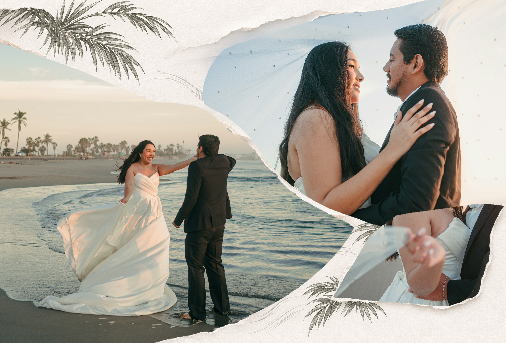

# 纸上相册 · Photo Album Skill

**保持原片一致性，让相册从你的照片出发。**

一个开源的 AI 摄影拼贴相册 Skill。AI 设计纸面、撕边、插画与构图，照片区域使用整块原片回贴，保留人物、表情、服装、动作与场景内容。



## 特点

- **原片回贴**：以完整相机场景覆盖照片区域，不依赖 AI 重绘人物。
- **有主次的跨页构图**：组合大场景、近景与细节，结合自然手撕边和环境版画。
- **尊重照片分组与文字**：保留用户确认的顺序、诗句、序言和献词。
- **从样张到整册**：先确认一张跨页，再继续制作并检查照片、文字、顺序与中缝。
- **图片与 PDF 导出**：配套照片配对检查和页面导出脚本。

原片一致性指照片内容与人物原貌。排版可能包含裁剪、等比缩放和旋转，输出文件并非未经变换的原文件逐像素不变；窄边缘过渡可能存在混合。

## 开始使用

```bash
git clone https://github.com/crown-hg-h/photo-album-skill.git
cd photo-album-skill
python3 -m pip install -r requirements.txt
```

在支持读取本地 Skill、处理文件和图像生成的 AI agent 工作环境中，提供原片、照片分组、页面规格及文字，并给出指令：

```text
请读取 photo-album/SKILL.md，使用我的照片制作摄影拼贴相册。
先核对照片分组，再设计一张跨页样张。
使用整块原片回贴保留照片内容，不单独重绘人脸。
等样张确认后，再继续制作整册。
```

图像生成工具、字体与图像处理能力需由运行环境提供。当前示例在 Codex 工具环境中制作，其他环境需适配。AI 工具的账户和额度由所用服务提供，仓库不包含生图服务。

## 配套脚本

需要 Python 3.11 或更新版本。照片配对检查脚本仅依赖标准库；PDF 导出脚本依赖 Pillow、pypdf 和 reportlab。

```bash
python3 photo-album/scripts/plan_album.py manuscript.json --out work/pairing.json
python3 photo-album/scripts/export_pdf.py pages.json --out album.pdf
```

清单格式与完整示例见 [分组与导出格式](photo-album/references/schemas.md)。脚本负责清单检查与 PDF 导出；AI 构图、原片对齐回贴和文字排版由 Skill 指导运行环境完成。

## 文件

- [Skill 入口](photo-album/SKILL.md)
- [构图、回贴与问题处理](photo-album/references/production.md)
- [照片分组与 PDF 清单格式](photo-album/references/schemas.md)
- [照片配对检查脚本](photo-album/scripts/plan_album.py)
- [PDF 导出脚本](photo-album/scripts/export_pdf.py)
- [跨页样张 PDF](docs/sample-spread.pdf)
- [摄影来源与说明](docs/photo-credits.txt)

示例为一张跨页、两个单页，图片尺寸为 **1512 × 1026**。先使用图像生成工具设计，再整块回贴原片。仓库不包含个人相册照片或图库原片包。

## 许可与摄影署名

原创代码与项目说明采用 [MIT License](LICENSE)。

示例摄影：**Fotógrafo Samuel Cruz / Unsplash**。示例图片和 PDF 含第三方摄影内容，不属于 MIT 许可范围；请查看[素材来源](docs/photo-credits.txt)、[Unsplash 许可](https://unsplash.com/license)及[平台条款](https://unsplash.com/terms)。人物仅用于素材演示，不代表合作或推荐。
